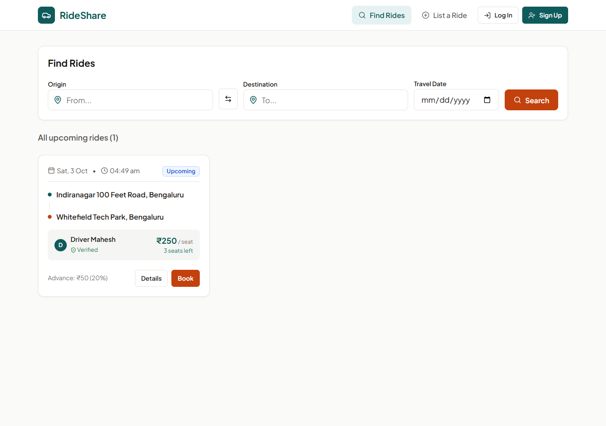
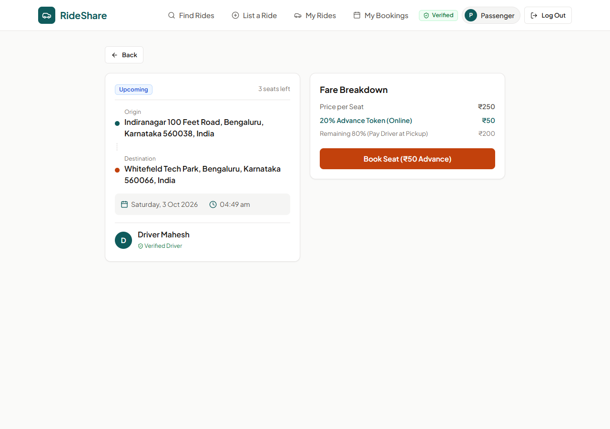
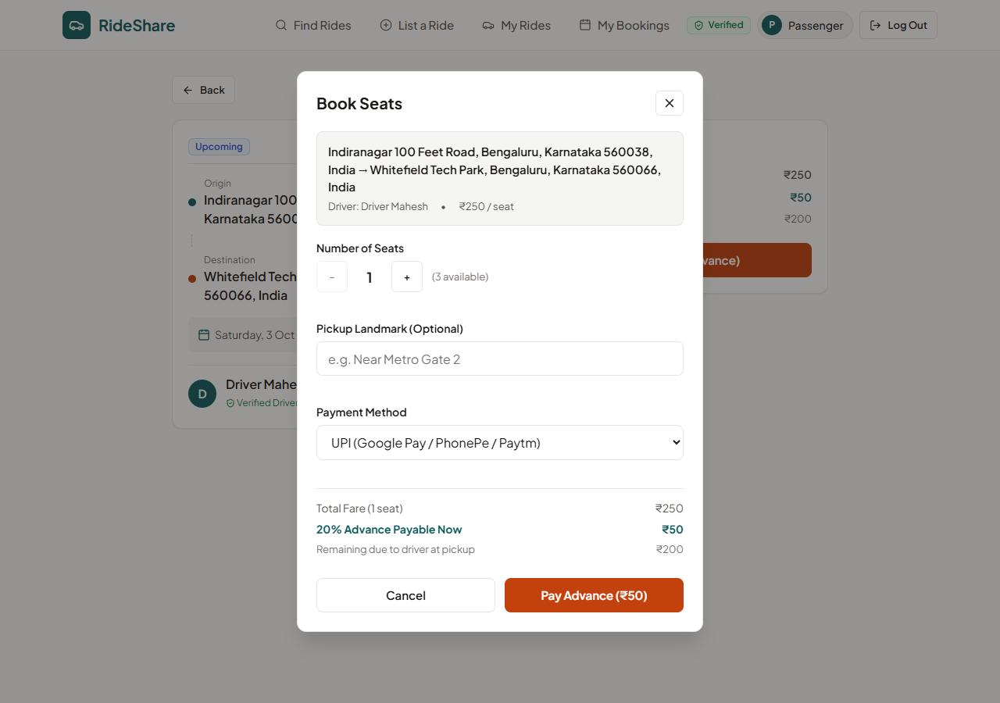
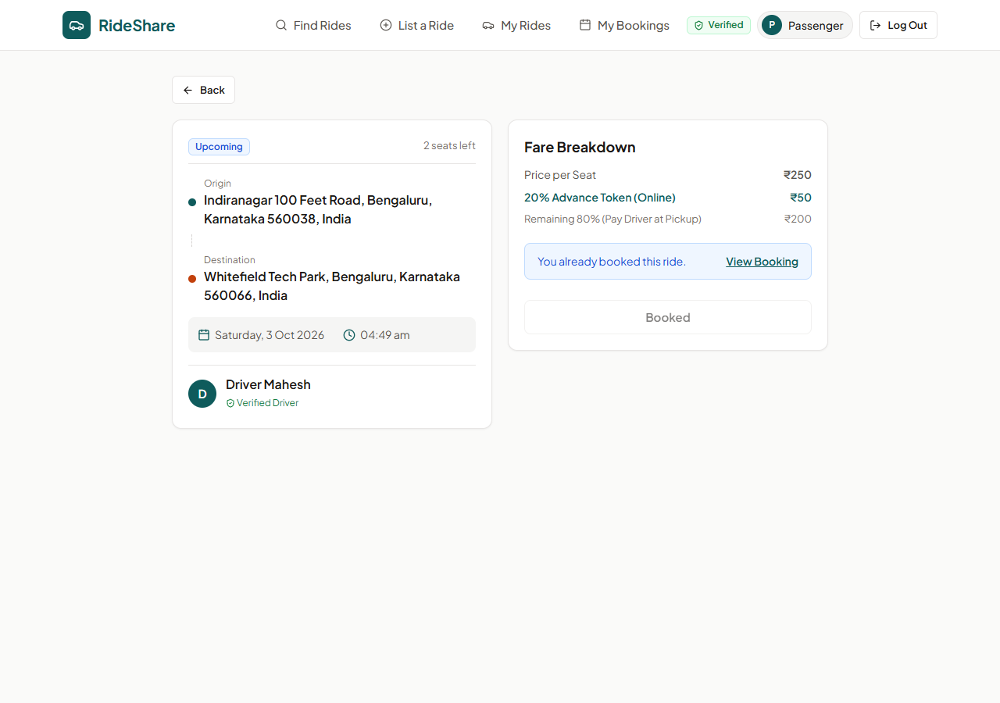
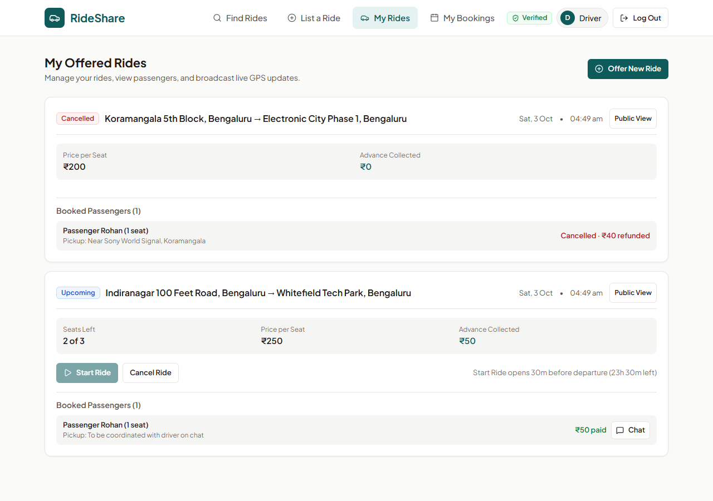
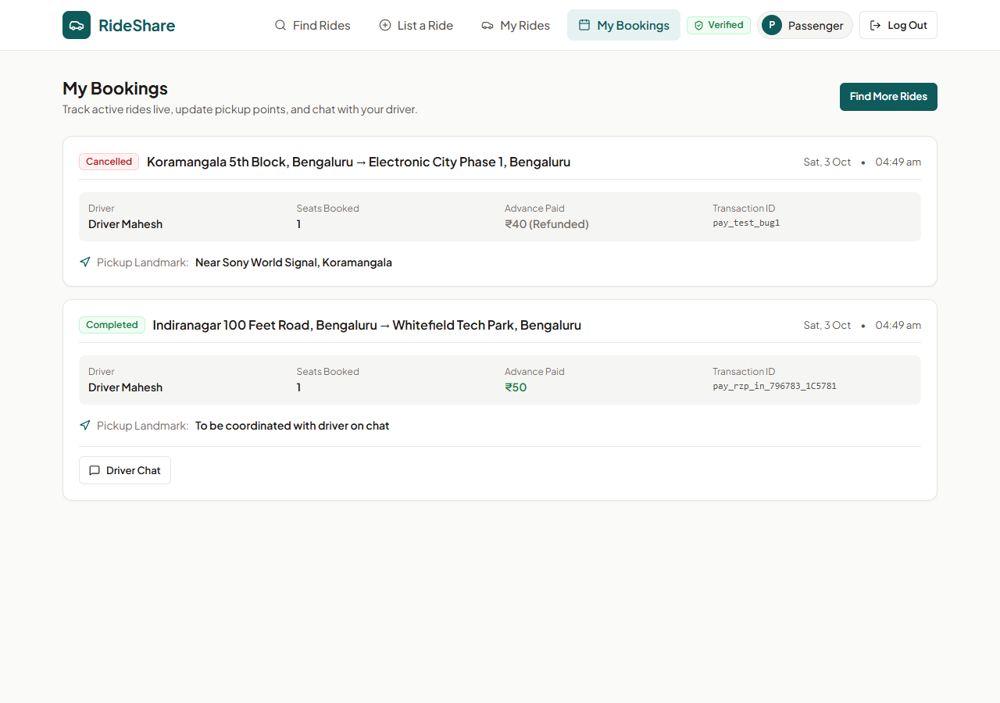

# RideShare - MERN Carpooling Web Application

RideShare is a carpooling web application where drivers list empty seats on their upcoming journeys and passengers can search, book seats with a 20% advance payment, chat with their driver, and track the driver's vehicle live during the trip. The application is built with MongoDB, Express, React, and Node.js, focusing on simple commuter carpooling with atomic seat inventory management and verification controls.

## Screenshots

The screenshots below show the core user interfaces of the application.


*Ride search interface with location autocomplete, swap button, and search results.*


*Ride details page showing seats left, vehicle information, and fare calculation.*


*Two-step booking modal calculating the 20% advance deposit and remaining cash balance.*


*Ride details view for a passenger who already has an active booking on the ride.*


*Driver dashboard view showing passenger bookings, pickup landmarks, and payment status.*


*Passenger dashboard displaying active and completed bookings with tracking and cancellation controls.*

## Features

- Email OTP verification: 6-digit verification code sent via Nodemailer with bcrypt hashing, a 10-minute expiry window, 5 maximum attempts, and a 60-second resend cooldown.
- JWT authentication: user registration and login with bcrypt password hashing and Bearer tokens for route authorization.
- Ride listing with location autocomplete: verified drivers can publish rides with origin, destination, departure time, vehicle details, seat capacity (1 to 8 seats), and price per seat.
- Search with filters and field swapping: passengers can search rides by destination with optional origin and date filters, case-insensitive partial text matching, and a one-click button to swap origin and destination. Drivers are automatically excluded from seeing their own rides in search.
- Booking with seat selection and pickup landmark: passengers select seat counts up to the available limit, enter custom pickup landmarks, and view an upfront fare breakdown (total fare, 20% advance payable now, and 80% balance due to driver in cash).
- Mock payment (20% advance): two-step transaction flow where an order is created and verified with a simulated transaction reference.
- Booking-scoped chat: driver and passenger can exchange messages in a dedicated thread scoped strictly to their confirmed booking ID.
- Live GPS tracking with Leaflet: drivers broadcast current GPS coordinates while a ride is in progress, and passengers can view the driver's location marker on an interactive OpenStreetMap map.
- Start and end ride lifecycle: drivers can only start a ride within 30 minutes before the scheduled departure time (or after departure). A ride can only transition to completed through an explicit End Ride action from the driver.
- Passenger and driver cancellation with mock refunds: passengers can cancel upcoming bookings to release seats back to inventory and receive an advance refund; drivers cancelling an upcoming ride cascade-refunds all booked passengers. Cancellation is disabled once a ride is in progress or completed.
- My Rides and My Bookings dashboards: drivers manage published rides, passenger pickup manifests, and earnings; passengers track ride progress, update pickup landmarks, and access chat.

## Tech Stack

Backend dependencies (from backend/package.json):
- Node.js (tested on v22.12.0)
- Express (^4.21.2)
- Mongoose (^8.9.2) with MongoDB
- jsonwebtoken (^9.0.2)
- bcryptjs (^2.4.3)
- nodemailer (^10.0.13)
- express-rate-limit (^8.7.0)
- express-validator (^7.3.2)
- cors (^2.8.5)
- dotenv (^16.4.7)
- Dev and test libraries: supertest (^7.3.0), puppeteer-core (^25.12.0), nodemon (^3.1.9)

Frontend dependencies (from frontend/package.json):
- React (^19.2.8) and React DOM (^19.2.8)
- React Router DOM (^7.18.4)
- Axios (^1.20.0)
- Vite (^8.3.0)
- Leaflet (^1.9.4) and React Leaflet (^5.0.0)
- Lucide React (^1.47.0)
- Plain CSS for styling

## How It Works (Architecture)

- MVC-style backend: the Express backend separates request routing (routes/), business logic (controllers/), database schemas (models/), auth and error validation (middleware/), and external utilities (services/).
- Polling over WebSockets: live vehicle coordinates poll every 10 seconds and booking messages poll every 3 seconds instead of using WebSockets. This simplifies deployment on standard HTTP hosting, avoids keeping persistent TCP connections open, and recovers cleanly from intermittent mobile network drops.
- Atomic seat decrement using conditional $inc: during booking verification, seats are decremented directly in MongoDB using a query condition `{ _id: rideId, seatsAvailable: { $gte: requestedSeats } }` and update operator `{ $inc: { seatsAvailable: -requestedSeats } }`. This prevents race conditions and overbooking when multiple passengers attempt to book simultaneously.
- Hashed OTPs with expiry and attempt limits: one-time passwords are generated as random 6-digit numbers, hashed with bcrypt before being saved in the database, and stored with an expiration timestamp and attempt counter. If 5 incorrect attempts occur, the code is invalidated.
- Server-side status guards: state transitions are strictly controlled on the backend. Only rides in upcoming status can be started, and only inside the 30-minute start window. Only the driver can start or end the ride. GPS updates or connection drops never mark a ride as completed.
- Mock payment flow: split into two steps imitating payment gateways like Razorpay. First, POST /api/payment/create-order creates a booking in pending_payment status and calculates the 20% advance token. Second, POST /api/payment/verify processes the simulated payment, checks seat availability, executes the atomic seat decrement, and updates the booking to confirmed with a mock transaction identifier.

## Folder Structure

```
backend/
|-- config/
|   |-- constants.js
|   `-- db.js
|-- controllers/
|   |-- authController.js
|   |-- bookingController.js
|   |-- messageController.js
|   |-- paymentController.js
|   `-- rideController.js
|-- middleware/
|   |-- auth.js
|   |-- errorHandler.js
|   |-- rateLimiter.js
|   `-- validator.js
|-- models/
|   |-- Booking.js
|   |-- Message.js
|   |-- Ride.js
|   `-- User.js
|-- routes/
|   |-- authRoutes.js
|   |-- bookingRoutes.js
|   |-- messageRoutes.js
|   |-- paymentRoutes.js
|   `-- rideRoutes.js
|-- scripts/
|   `-- clear-database.js
|-- services/
|   |-- emailService.js
|   `-- paymentService.js
|-- tests/
|   |-- test-api.js
|   |-- test-browser-e2e.js
|   |-- test-suite-e2e.js
|   `-- verify-all-16-browser.js
|-- .env.example
|-- package.json
`-- server.js

frontend/
|-- public/
|   |-- favicon.svg
|   `-- icons.svg
|-- src/
|   |-- assets/
|   |-- components/
|   |   |-- Alert.jsx
|   |   |-- BookingModal.jsx
|   |   |-- ChatDrawer.jsx
|   |   |-- DriverTrackingController.jsx
|   |   |-- LiveTrackingMap.jsx
|   |   |-- LoadingSpinner.jsx
|   |   |-- LocationInput.jsx
|   |   |-- Navbar.jsx
|   |   |-- ProtectedRoute.jsx
|   |   `-- RideCard.jsx
|   |-- constants/
|   |   `-- index.js
|   |-- context/
|   |   `-- AuthContext.jsx
|   |-- hooks/
|   |   |-- useAuth.js
|   |   |-- usePolling.js
|   |   `-- useRelativeTime.js
|   |-- pages/
|   |   |-- CreateRidePage.jsx
|   |   |-- HomePage.jsx
|   |   |-- LoginPage.jsx
|   |   |-- MyBookingsPage.jsx
|   |   |-- MyRidesPage.jsx
|   |   |-- RegisterPage.jsx
|   |   |-- RideDetailsPage.jsx
|   |   |-- SearchRidesPage.jsx
|   |   `-- VerifyOtpPage.jsx
|   |-- services/
|   |   |-- api.js
|   |   |-- authService.js
|   |   |-- bookingService.js
|   |   |-- messageService.js
|   |   |-- paymentService.js
|   |   `-- rideService.js
|   |-- utils/
|   |   `-- formatters.js
|   |-- App.css
|   |-- App.jsx
|   |-- index.css
|   `-- main.jsx
|-- .env.example
|-- index.html
|-- package.json
`-- vite.config.js
```

## Getting Started

### Prerequisites

- Node.js (version 18 or above, tested with v22.12.0)
- MongoDB (running locally at mongodb://127.0.0.1:27017 or a MongoDB Atlas connection string)
- npm package manager

### Environment Configuration

The application uses environment variables in both the backend and frontend directories. Create a `.env` file in each directory based on the provided `.env.example` templates.

Backend environment variables (backend/.env):

| Variable | Description | Example Value |
| --- | --- | --- |
| PORT | Port for the Express server | 5000 |
| NODE_ENV | Application environment | development |
| CLIENT_URL | Frontend application URL for CORS | http://localhost:5173 |
| MONGO_URI | MongoDB connection string | mongodb://localhost:27017/rideshare |
| MONGO_URI_TEST | MongoDB test database connection string | mongodb://localhost:27017/rideshare_test |
| JWT_SECRET | Secret key for signing JSON Web Tokens | your_jwt_secret_key_minimum_32_characters |
| JWT_EXPIRES_IN | Expiry duration for authentication tokens | 7d |
| EMAIL_USER | Gmail address for sending verification emails | your_email@gmail.com |
| EMAIL_PASS | Gmail App Password for SMTP authentication | your_gmail_app_password |

Frontend environment variables (frontend/.env):

| Variable | Description | Example Value |
| --- | --- | --- |
| VITE_API_URL | Backend API base URL | http://localhost:5000/api |
| VITE_DEV_TOOLS | Show developer assistance helpers | false |

Note on email verification in development: If EMAIL_USER and EMAIL_PASS are left empty in backend/.env, Nodemailer email sending is skipped and the 6-digit OTP code is printed directly to the backend terminal console (for example: `[Dev OTP Fallback] driver@test.com: 123456`). You can copy this code directly to verify the account.

### Installation and Running

1. Clone the repository:
   ```bash
   git clone <repository-url>
   cd car_Poolong
   ```

2. Install backend dependencies and start the server:
   ```bash
   cd backend
   npm install
   cp .env.example .env
   npm run dev
   ```
   The backend server runs at http://localhost:5000.

3. Install frontend dependencies and start the development server:
   ```bash
   cd ../frontend
   npm install
   cp .env.example .env
   npm run dev
   ```
   The frontend application runs at http://localhost:5173.

## Running Tests

The test suites run against an isolated test database defined by MONGO_URI_TEST (defaulting to mongodb://127.0.0.1:27017/rideshare_test). Test collections are wiped before and after each test run so that your main development database is not modified.

Run the API test suite:
```bash
cd backend
npm run test:api
```
Result: 27 / 27 passed (0 failed).

Run the end-to-end integration suite:
```bash
cd backend
npm run test:e2e
```
Result: 41 / 41 passed (0 failed).

Total automated test count: 68 passed assertions across both test suites.

Note: These automated tests cover API endpoints, concurrency checks, cancellation cascades, and role authorization. User interface flows were tested and verified manually in the browser.

## API Overview

| Method | Path | Auth | Purpose |
| --- | --- | --- | --- |
| POST | /api/auth/register | Public | Register a new driver or passenger account |
| POST | /api/auth/login | Public | Authenticate user and receive JWT (rate limited) |
| POST | /api/auth/send-otp | Public | Request a 6-digit email OTP (rate limited) |
| POST | /api/auth/verify-otp | Public | Verify OTP code and mark account as verified |
| GET | /api/auth/me | Bearer Token | Retrieve profile of the current authenticated user |
| POST | /api/rides | Bearer Token, Verified | Create and publish a new ride |
| GET | /api/rides | Public | Search rides by destination, origin, and date |
| GET | /api/rides/locations | Public | Get location autocomplete suggestions |
| GET | /api/rides/my-rides | Bearer Token | Get all rides published by the logged-in driver |
| GET | /api/rides/:id | Public | Get full details for a specific ride |
| PATCH | /api/rides/:id/status | Bearer Token | Update ride status (in progress, completed) |
| POST | /api/rides/:id/location | Bearer Token | Update and broadcast driver live GPS coordinates |
| GET | /api/rides/:id/location | Bearer Token | Poll latest GPS location of the driver |
| PATCH | /api/rides/:id/cancel | Bearer Token | Cancel an upcoming ride and refund all passengers |
| GET | /api/bookings/my-bookings | Bearer Token | Retrieve all bookings made by the logged-in passenger |
| GET | /api/bookings/:id | Bearer Token | Retrieve details for a specific booking |
| PATCH | /api/bookings/:id/pickup | Bearer Token | Update pickup landmark notes for a booking |
| PATCH | /api/bookings/:id/cancel | Bearer Token | Cancel a booking, refund advance, and release seats |
| POST | /api/payment/create-order | Bearer Token, Verified | Initialize booking order and calculate 20% advance |
| POST | /api/payment/verify | Bearer Token | Process mock payment and confirm seat reservation |
| POST | /api/messages | Bearer Token | Send an in-app message scoped to a booking |
| GET | /api/messages/:bookingId | Bearer Token | Fetch chronological message history for a booking |

## Known Limitations

- Payment is simulated: the app calculates a genuine 20% advance token and creates unique mock payment references, but it does not connect to a live payment gateway such as Razorpay or Stripe.
- HTTP polling instead of WebSockets: driver GPS locations poll every 10 seconds and in-app chat polls every 3 seconds. While reliable, this generates periodic HTTP requests rather than instant socket pushes.
- Developer tools flag in frontend: if VITE_DEV_TOOLS is set to "true" in frontend/.env, a box showing the dev OTP code is displayed on the OTP verification page, and a checkbox to simulate bank payment failure is shown in the booking modal. When VITE_DEV_TOOLS is set to "false" or omitted, these developer elements are completely hidden from the user interface.
- No rating or review system: users cannot rate drivers or leave written feedback after completing a ride.
- Geocoding rate limits: location suggestions search existing rides in the database first, and fall back to the public OpenStreetMap Nominatim API, which has standard rate limits.
- No load testing: the system has been tested for correctness and database concurrency, but has not been benchmarked under heavy concurrent traffic.

## Future Improvements

- Socket.io integration: replace HTTP polling with WebSockets for real-time chat and live driver location marker movement.
- Payment gateway integration: add Razorpay test mode or Stripe checkout with webhook verification for live payment processing.
- SMS OTP delivery: add SMS-based OTP verification using services like Twilio or Fast2SMS alongside email.
- Ratings and reviews: allow passengers and drivers to rate each other out of 5 stars with written reviews after trip completion.
- Route-based matching: match rides along intermediate route coordinates rather than requiring exact origin and destination city matches.
- Push notifications: notify passengers when a driver starts the ride or sends a new chat message.

## Author

Built by <your name> as an academic project
